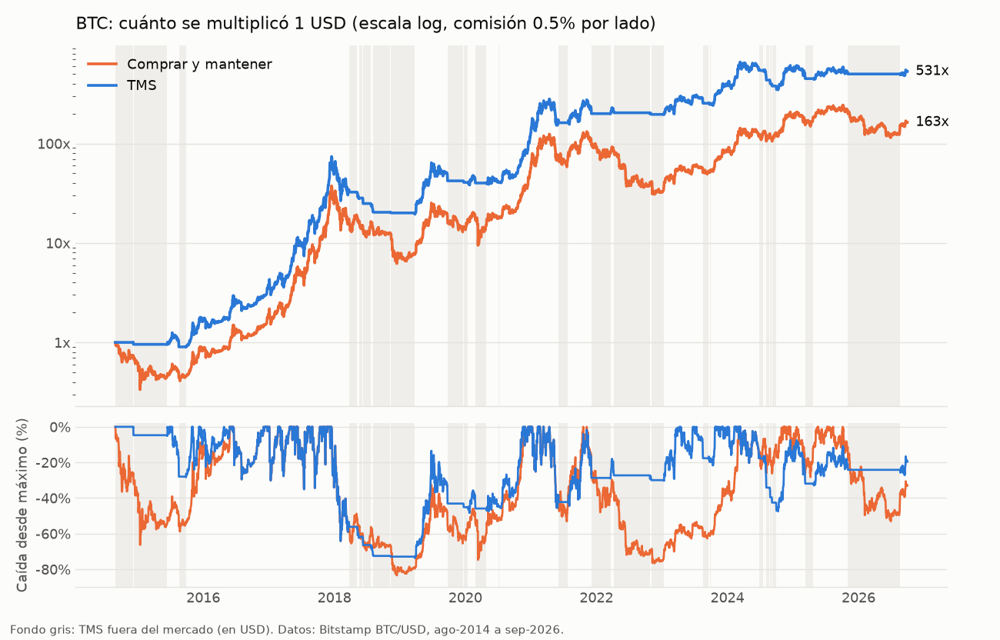

# TMS: indicador de tendencia para cripto (solo compra, para Zesty)

Datos históricos, un indicador simple y su backtest con las comisiones de Zesty
(0.4% por compra y 0.4% por venta, más 0.1% de deslizamiento supuesto = **0.5% por lado**).



## Las reglas (todo en velas diarias, cierre 00:00 UTC)

**TMS (Trend Momentum Score)** cuenta cuántos de estos 4 "votos" son positivos:

| Voto | Pregunta |
|---|---|
| 1 | ¿El cierre de hoy es mayor que el de hace **30** días? |
| 2 | ¿… mayor que el de hace **60** días? |
| 3 | ¿… mayor que el de hace **120** días? |
| 4 | ¿… mayor que el de hace **240** días? |

- **Comprar** cuando hay **3 o 4** votos positivos.
- **Vender** (pasar todo a USD) cuando quedan **0 o 1**.
- Con 2 votos: **no hacer nada** (mantener lo que tengas). Esa zona muerta evita
  entrar y salir a cada rato pagando comisión.
- **Altcoins:** comprar una alt solo si su TMS dice comprar **y** el TMS de BTC
  también. Si BTC pasa a vender, se vende también la alt.

Son ~2 operaciones al año en BTC. El cierre diario UTC es a las 21:00 en Chile con
horario de verano (sep–abr) y a las 20:00 en invierno (abr–sep). Revisar la señal
a esa hora y operar en Zesty.

### Usarlo en TradingView

Zesty no permite indicadores propios, así que la señal se mira en TradingView y la
orden se ejecuta a mano en Zesty:

1. Abrir TradingView → Pine Editor → pegar [`TMS.pine`](TMS.pine) → "Add to chart".
2. Usar el gráfico **diario** de un par en USD (ej. `BITSTAMP:BTCUSD`, `COINBASE:ETHUSD`).
3. Crear alertas "TMS compra" y "TMS venta" con la opción *Once per bar close*.

Columnas verdes = votos ≥ 3, rojas = votos ≤ 1; fondo verde = posición comprada.

## Resultados

Los parámetros (30/60/120/240 días, comprar ≥3, vender ≤1) se eligieron **solo
con datos 2014–2020**. 2021–2026 no se usó para elegir nada: es la prueba honesta.

### BTC (Bitstamp BTC/USD, ago-2014 → 30-sep-2026)

| Período | Estrategia | Retorno anual | Caída máx. | Sharpe | Tiempo invertido | Operaciones |
|---|---|---:|---:|---:|---:|---:|
| 2014–2020 (diseño) | Comprar y mantener | 88.9% | -83.4% | 1.23 | 100% | 1 |
| | SMA200 (referencia) | 101.5% | -68.2% | 1.49 | 61% | 11 |
| | **TMS** | **114.8%** | -73.7% | **1.58** | 64% | 13 |
| 2021–2026 (fuera de muestra) | Comprar y mantener | 19.8% | -76.7% | 0.60 | 100% | 1 |
| | SMA200 (referencia) | 14.8% | -66.8% | 0.54 | 55% | 27 |
| | **TMS** | **27.7%** | **-47.5%** | **0.78** | 58% | 14 |
| Total | Comprar y mantener | 52.4% | -83.4% | 0.97 | 100% | 1 |
| | **TMS** | **68.0%** | -73.7% | **1.25** | 61% | 26 |

Retorno por año (%):

| Año | 2014* | 2015 | 2016 | 2017 | 2018 | 2019 | 2020 | 2021 | 2022 | 2023 | 2024 | 2025 | 2026** |
|---|---|---|---|---|---|---|---|---|---|---|---|---|---|
| TMS | -4.5 | 74.0 | 124.3 | 1336.4 | -62.6 | 102.7 | 214.5 | 56.3 | **-1.8** | 94.3 | 40.8 | -6.8 | 6.2 |
| Comprar y mantener | -37.3 | 34.2 | 124.3 | 1336.4 | -73.4 | 94.1 | 304.5 | 59.4 | **-64.2** | 155.7 | 121.0 | -6.3 | -4.5 |

\* desde el 29-ago-2014 · \** hasta el 30-sep-2026

**Robustez:** probé 30 combinaciones de parámetros (horizontes ×0.5 a ×2,
distintos umbrales). En BTC, 28 de 30 superan el Sharpe de comprar y mantener
tanto en 2014–2020 como en 2021–2026, y en 2021–2026 **las 30** tienen menor
caída máxima. Las 2 que fallan son las versiones más rápidas (horizontes de
10–80 días). No depende de un número mágico.

**Retraso y comisiones:** operar 1 día tarde casi no cambia nada (CAGR 67.2% vs
68.0%). Con comisión de 1% por lado el retorno anual sigue en 64.5%
([`btc_sensibilidad.csv`](resultados/btc_sensibilidad.csv)).

### Altcoins (mediana de 12: ETH, LTC, BCH, DOGE, LINK, UNI, AAVE, DOT, XRP, ADA, XLM, TRX)

| Período | Estrategia | Retorno anual | Caída máx. | Sharpe | Monedas con ganancia |
|---|---|---:|---:|---:|---:|
| 2021–may 2026 (fuera de muestra) | Comprar y mantener | 1.3% | -90.1% | 0.46 | 7/12 |
| | TMS solo | 11.0% | -82.8% | 0.49 | 7/12 |
| | **TMS + régimen BTC** | **19.7%** | **-73.7%** | **0.59** | 7/12 |
| Total | Comprar y mantener | 33.1% | -93.0% | 0.76 | 8/12 |
| | **TMS + régimen BTC** | **35.6%** | **-80.4%** | **0.76** | 9/12 |

Detalle por moneda en [`resultados/resumen.csv`](resultados/resumen.csv).

## Advertencias (léelas)

- **No vende en el máximo.** Es seguidor de tendencia: entra tarde y sale tarde. En
  2018 devolvió buena parte de la subida de 2017 (caída máxima -74%).
- **Pierde más veces de las que gana:** 11 de 26 operaciones en BTC fueron
  ganadoras. La pérdida típica es chica (-7% en promedio), pero el resultado
  depende de pocas tendencias grandes (2015–2018: +3501%; 2020–2021: +295%).
  Si te saltas una entrada "porque ya subió mucho", puedes perderte el año.
- **En altcoins las caídas siguen siendo enormes** (-74% mediana aun con el filtro).
  El indicador ayuda, pero las alts de 2021–2026 en general perdieron valor frente
  al dólar. BTC es donde el resultado es claro.
- **Rentabilidad pasada no asegura rentabilidad futura.** Esto es un backtest, no
  una recomendación de inversión.
- El backtest supone todo-o-nada (100% cripto o 100% USD). Puedes aplicar la señal
  solo a la parte de tu cartera que destines a cripto.

## Archivos

| Archivo | Contenido |
|---|---|
| `data/BTCUSD_1d.csv`, `_4h.csv`, `_1h.csv` | BTC/USD OHLCV de Bitstamp, 2014-01-01 → 2026-09-30 |
| `data/crypto_daily_close_usd.csv` | Cierre diario en USD de 12 altcoins (Coin Metrics), → 2026-05-24 |
| `backtest.py` | Indicadores (TMS, SMA200, cruce EMA, Donchian) y motor de backtest |
| `run_backtest.py` | Reproduce todas las tablas en `resultados/` |
| `grafico.py` | Genera `resultados/btc_tms.png` |
| `build_data.py` | Vuelve a descargar y actualizar `data/` |
| `TMS.pine` | El indicador para TradingView, con alertas |
| `resultados/btc_operaciones.csv` | Cada operación de BTC con fechas y precios |
| `resultados/senales_actuales.csv` | Señal en el último dato disponible |

```bash
pip install pandas numpy matplotlib
python3 build_data.py     # opcional: actualiza los datos
python3 run_backtest.py   # tablas y señal actual
python3 grafico.py        # gráfico
```

Fuentes de datos: [ff137/bitstamp-btcusd-minute-data](https://github.com/ff137/bitstamp-btcusd-minute-data)
(BTC a 1 minuto, se actualiza a diario) y [Coin Metrics Community Data](https://github.com/coinmetrics/data)
(dejó de actualizarse el 24-may-2026; SOL, AVAX y SHIB no traen precio ahí).
Comisión de Zesty: [CNN Chile](https://www.cnnchile.com/negocios/zesty-criptomonedas-cmf-plataforma-inversion-2026/).
